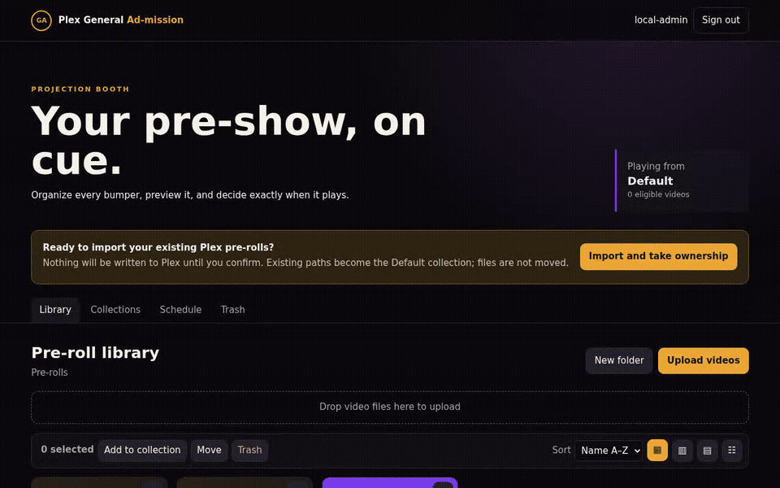

# Plex General Ad-mission

**Your pre-show, on cue.** Plex General Ad-mission is a self-hosted manager for
organizing, previewing, uploading, and scheduling Plex pre-roll videos. 



## Features

- Browse nested folders with generated thumbnails and in-browser video previews.
- Upload by file picker or drag-and-drop; create, rename, move, trash, and restore items.
- Build reusable collections from individual videos or dynamic recursive folders.
- Schedule one-time, daily, weekly, monthly, or annual windows in your timezone.
- Combine overlapping schedules and ask Plex to randomly choose one eligible video.
- Keep a Default collection for dates without an active scheduled season.
- Authenticate through Plex and allow only named Plex administrators.
- Preserve deleted media in a separate trash volume before automatic expiry.
- Expose a data-free `/healthz` endpoint for container and uptime monitoring.

The application uses Plex's supported preferences API. It does not edit Plex's
`Preferences.xml` or restart Plex.

## Quick start

Requirements are Docker Compose, a Plex server-owner token, and a directory that is
also mounted into Plex. Copy `.env.example` to `.env`, edit every placeholder, then:

```sh
mkdir -p data prerolls trash
docker compose up -d
```

Open `http://localhost:8080`. For anything beyond local evaluation, put the service
behind an HTTPS reverse proxy, change `PUBLIC_URL` to its exact origin, and set
`SESSION_COOKIE_SECURE=true`.

### Path mapping

`PREROLL_HOST_PATH` is the host directory mounted at `/prerolls` in this container.
`PLEX_PATH_PREFIX` is the path Plex sees. For example, both containers may mount the
same host directory differently:

```env
PREROLL_HOST_PATH=/volume1/Media/Prerolls
PLEX_PATH_PREFIX=/prerolls
```

Every selected relative filename is appended to `PLEX_PATH_PREFIX` before the
semicolon-separated random-choice list is sent to Plex.

## Plex configuration

1. Enable cinema trailers/pre-rolls in Plex clients as usual.
2. Create a server-owner token following Plex's documentation and place it only in
   the protected `.env` as `PLEX_TOKEN`.
3. Set `PLEX_URL` to an address reachable from the container.
4. Set `ALLOWED_PLEX_USERS` to one or more comma-separated Plex usernames.
5. Sign in through Plex. Passwords are entered only on Plex's site, and the temporary
   user token is discarded after identity verification.

The first managed synchronization replaces Plex's Movie pre-roll setting. Existing
files are never moved automatically. Add them to the Default collection before
enabling a schedule.

## Scheduling behavior

Dates use `TZ`. A schedule has a start, end, collection, and optional RFC 5545-style
recurrence rule. The UI offers daily, weekly, monthly, and yearly presets; advanced
users can supply a compatible `RRULE`, such as `FREQ=YEARLY;BYMONTH=12;BYMONTHDAY=1`.

All active schedules are combined and duplicate files removed. A folder selection is
resolved recursively at evaluation time. If no schedule is active, Default is used.
Plex receives stable, alphabetically ordered paths separated by semicolons, causing
it to choose one at random. The scheduler re-evaluates at least once per minute and
after changes. Failed syncs never clear the last valid Plex value.

## Data, backup, and upgrades

Back up `/app/data`, which contains SQLite state, the generated session secret, and
thumbnail cache. Back up the preroll and trash host directories separately. Stop the
container or use SQLite's backup API for a transactionally consistent database copy.

Before upgrading, record the running image digest and take a backup. Pull a versioned
release, recreate only this service, verify `/healthz`, login, schedules, preview, and
Plex sync. To roll back, restore the previous image digest while preserving all three
mounted directories.

## Security notes

- Never expose the service over plain HTTP outside localhost.
- Protect `.env` and `/app/data`; both contain sensitive material.
- The image runs as UID 1000 without Linux capabilities or new privileges.
- Symlinks and paths escaping `/prerolls` are rejected.
- Uploads use temporary partial files and are promoted only when complete.
- File deletion is recoverable; expired trash is permanently purged after 30 days by default.

## Development

```sh
python -m venv .venv
. .venv/bin/activate
pip install -e '.[test]'
AUTH_ENABLED=false SESSION_COOKIE_SECURE=false DATA_ROOT=/tmp/pga-data \
  PREROLL_ROOT=/tmp/pga-prerolls TRASH_ROOT=/tmp/pga-trash uvicorn app.main:app --reload
pytest
```

This project is not affiliated with or endorsed by Plex, Inc. or General Admission.
